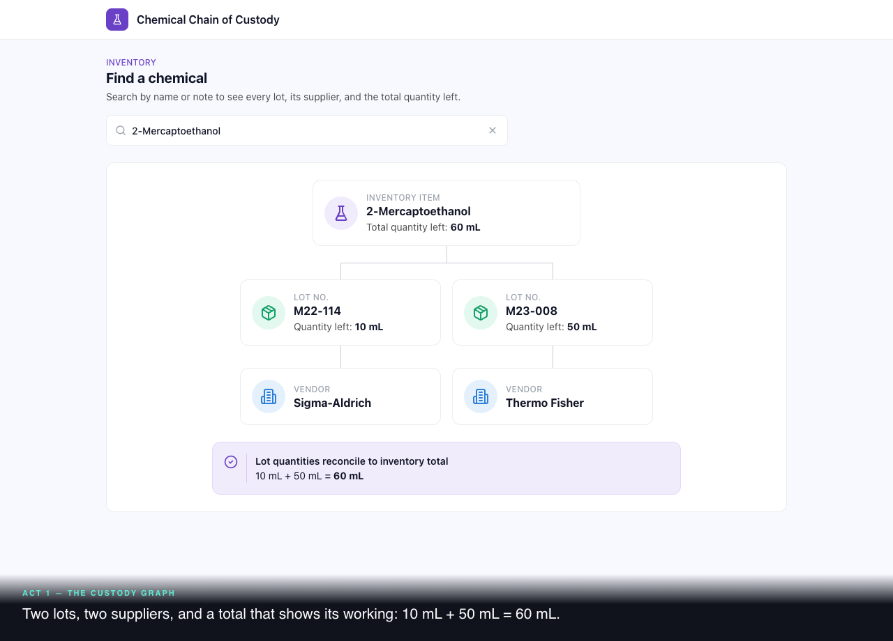
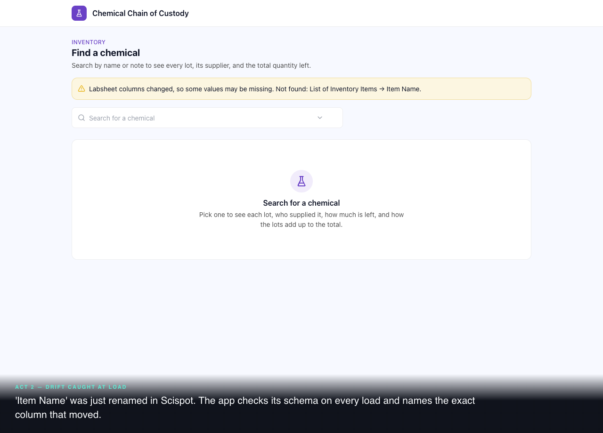
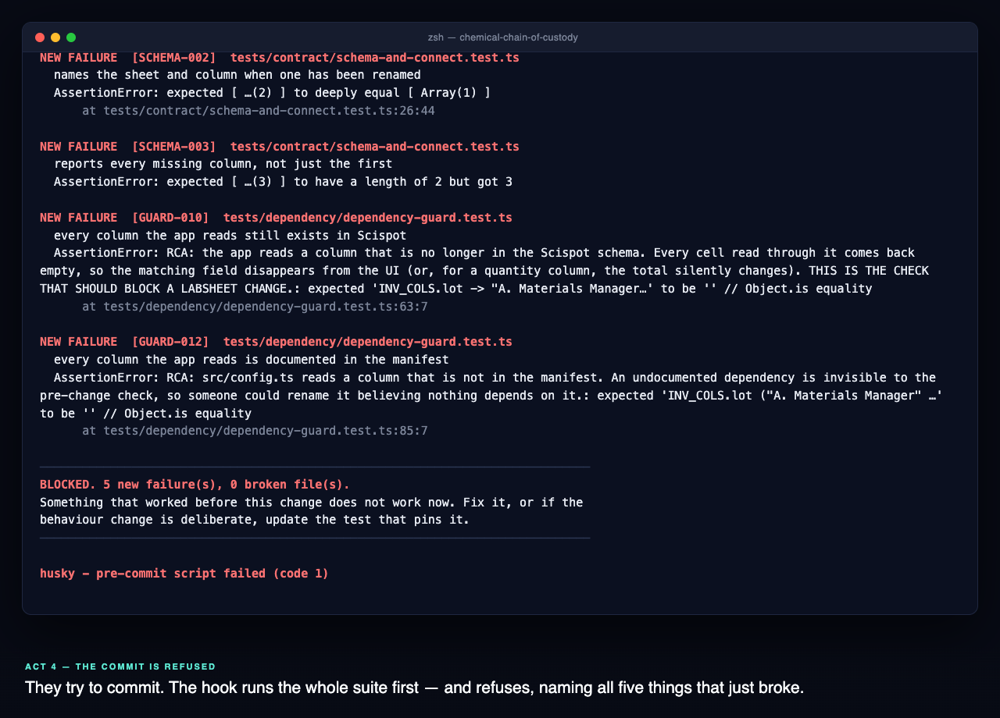
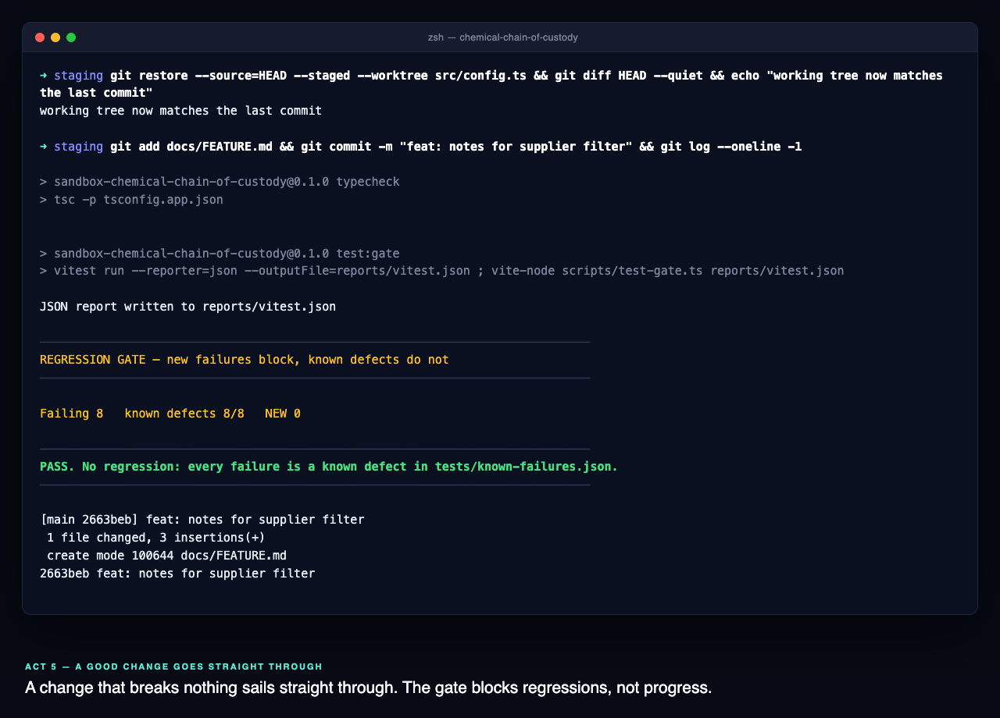

# Chemical Chain of Custody

A Scispot Jazz app that answers one question a lab asks constantly — *how much of this chemical do we actually have, and where did it come from?* — and a regression guardrail that stops anyone breaking it.


---

## The problem this solves

Lab inventory lives across several Scispot labsheets. A chemical's catalogue entry is in one sheet, the physical bottles in another, the supplier in a third. To answer "how much 2-Mercaptoethanol is on the shelf", someone opens three sheets and adds up by hand — in whatever units each lot happens to use.

This app renders that as a custody graph: the chemical, every lot of it, the supplier behind each lot, and a reconciled total that shows its working.

<p align="center">
  
</p>

## The harder problem

The app reads **18 named columns across 3 Scispot labsheets**. Any lab admin can rename one, at any time, without telling anyone. When that happens the naive outcome is silent: the field reads empty, the total drops, and a chemist trusts a screen that is confidently wrong.

So the app checks its own schema on every load and names the exact column that moved:

<p align="center">
  
</p>

---

## The regression guardrail

**191 automated checks** run against this codebase — 142 logic, contract and dependency tests, plus 49 browser tests driving the real UI.

They run automatically on every commit and every push. A failure that is not an already-documented defect **blocks the operation**.

| Stage | Trigger | What runs | Time |
|---|---|---|---|
| `pre-commit` | `git commit` | TypeScript + 142 logic/contract/dependency checks | ~3s |
| `pre-push` | `git push` | the above + 49 browser tests | ~13s |
| CI | push / PR to `main` | everything, plus a published QA report | ~2min |

### What that looks like when someone breaks something

A developer renames a column constant while adding a feature. One character. The commit never happens:

<p align="center">
  
</p>

Revert the rename, and a change that breaks nothing goes straight through — same gate, same suite, opposite outcome:

<p align="center">
  
</p>

### Why it is not simply "all tests must pass"

Eight checks are **red on purpose**. Each pins a real, unfixed defect — a comma decimal that parses as `NaN`, two Scispot unit options the totals ignore, a sheet missing from the load-time check. They are listed in [`tests/known-failures.json`](tests/known-failures.json) with the defect each one documents.

A plain "everything green" gate would force those bugs to be hidden with `skip` to let any work proceed. Instead the rule is **don't make it worse**:

```
Failing 8   known defects 8/8   NEW 0
PASS. No regression: every failure is a known defect in tests/known-failures.json.
```

Break something that previously worked and the same gate refuses it, naming what broke:

```
Failing 13   known defects 8/8   NEW 5
NEW FAILURE  [GUARD-010]  tests/dependency/dependency-guard.test.ts
NEW FAILURE  [SCHEMA-001] tests/contract/schema-and-connect.test.ts
...
BLOCKED. 5 new failure(s), 0 broken file(s).
```

Fix a defect and the gate tells you to remove it from the baseline, so the list cannot quietly go stale.

### Every failure names its own consequence

No test here is called `test_search_2`. Each carries an ID, what it checks, and the user-visible consequence of it failing — so a red build is a work order, not a mystery:

> **GUARD-020** — every Unit option in Scispot is understood as a real measure
> *These Unit dropdown options are missing from `UNIT_TABLE` (src/lib/quantity.ts:18), so `amount()` falls back to family 'count'. Lots measured in them are NEVER added into the mass or volume total and never appear in the reconcile banner — the total shown is lower than reality, with no warning.*

---

## Demo

A 1 minute 44 second recorded walkthrough, in six acts:

1. **The product** — synonym search, the custody graph, a lot's audit record
2. **The risk** — a Scispot column renamed mid-flight, caught at load
3. **The suite running** — the real gate, in a real terminal
4. **A regression refused** — a commit genuinely blocked, on camera
5. **The fix, then a clean commit** — the gate blocks regressions, not progress
6. **The ledger** — 191 checks, each with its root cause

**[docs/media/custody-demo.webm](docs/media/custody-demo.webm)**

Acts 3–5 are not a reenactment. [`demo/capture-session.ts`](demo/capture-session.ts) clones this repo into a throwaway workspace, activates the hooks, genuinely breaks a column name, and records whatever the commands actually print — including the blocked commit and its exit code. The video replays that captured output. Regenerate both any time:

```bash
npx vite-node demo/capture-session.ts   # re-capture the terminal session
npm run demo:video                      # re-record, writes demo-output/
```

To watch the guardrail refuse a schema change live, in the terminal:

```bash
npm run demo:guard
```

---

## Running it

```bash
npm install                # also installs the git hooks
npx playwright install chromium

npm run dev                # the app, against a live Scispot session
npm test                   # 142 logic / contract / dependency checks
npm run test:e2e           # 49 browser checks
npm run test:gate          # the regression gate, as the hooks run it
npm run test:report        # writes reports/test-report.html
```

> The hooks only protect a machine that has run `npm install` — that is what activates Husky. The CI workflow is the check nobody can skip.

## Layout

| Path | What it is |
|---|---|
| [src/](src/) | the Jazz app — React, talking to Scispot through `window.Scispot` |
| [src/lib/sdk.ts](src/lib/sdk.ts) | the only place the Scispot SDK is touched |
| [src/config.ts](src/config.ts) | every labsheet and column name the app depends on |
| [tests/dependency/](tests/dependency/) | the dependency guard — code vs manifest vs captured Scispot schema |
| [tests/deps/scispot-snapshot.json](tests/deps/scispot-snapshot.json) | the captured schema the guard compares against |
| [tests/known-failures.json](tests/known-failures.json) | the eight defects that are red on purpose |
| [scripts/test-gate.ts](scripts/test-gate.ts) | the baseline diff that decides whether a commit proceeds |
| [e2e/](e2e/) | 49 browser tests against a stand-in Scispot SDK — no token, no network |
| [demo/](demo/) | the recorded client walkthrough, and the capture script behind its terminal acts |
